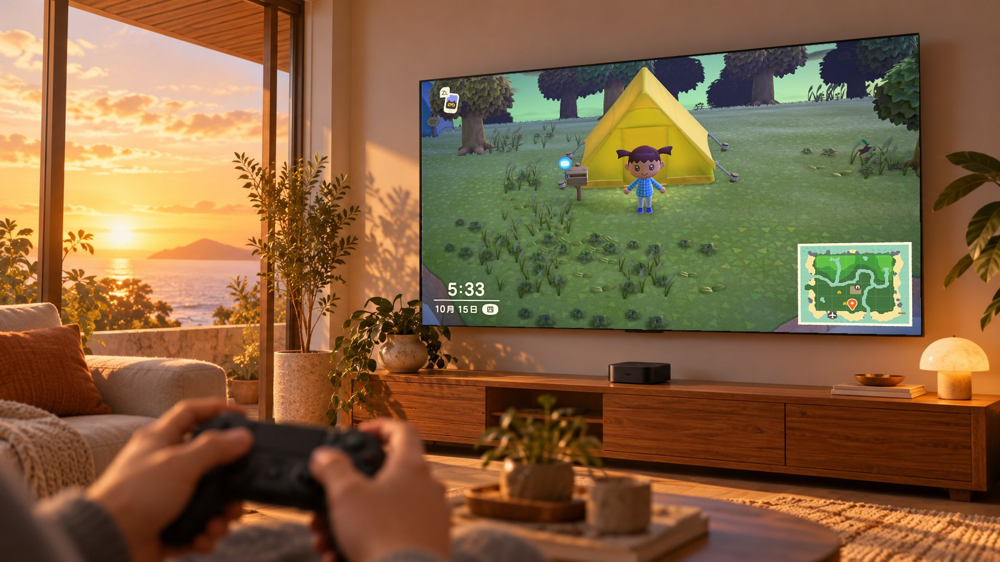
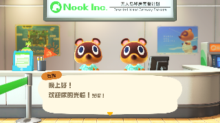
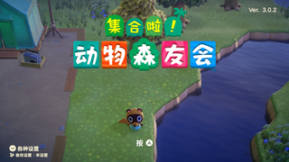

# Switch → Apple Platform Native Port — a Claude Code Skill



*Illustration generated with AI — not a real screenshot. Real captures from the Apple TV are below.*

A distilled playbook for running Nintendo Switch games natively on Apple Silicon — iPhone, iPad, Mac, and Apple TV — without CPU emulation. It was built from a real port: Animal Crossing: New Horizons (Switch) running and playable on an Apple TV 4K.

"Native" means the game's own ARM64 code runs as-is on the Apple CPU; system services are replaced by host HLE; graphics are re-encoded from NVN to Metal; shaders are translated offline.

## Results: ACNH on Apple TV 4K (3rd gen, A15)

| Capture | Scene |
|---|---|
|  | Release build on real hardware: the Nook Inc. counter |
|  | Real hardware: Timmy & Tommy's dialogue (game's own Chinese text) |
|  | Real hardware: on the island |
|  | Real hardware: island, another spot |
|  | Mac host: title screen after save-and-end |
|  | Mac host: welcome dialogue |
|  | Mac host: the dock |
|  | Mac host: the plaza |
|  | The synthetic test NSO that validated the whole pipeline (loader → rewriting → HLE → guest thread → NVN→Metal) before any game file was touched |

All captures are from the authors' own devices, downscaled to thumbnails.

Measured on the Apple TV 4K (3rd gen, A15, 4 GB):

| Metric | Value |
|---|---|
| First frame, fresh install | 1.6 s |
| Counter scene | 30 fps beat, frame time p50 33.4 ms |
| Island outdoors | p50 ~28 ms / p95 ~36 ms — 30 fps |
| Memory | peak ~1.8 GiB against a 2.05 GiB per-app cap |
| Audio | yes — in-game audio verified by RMS, not just callback counts |
| Opening movie | plays with audio (Vorbis track decoded by vendored libvorbis) |
| Save / title / load | closed loop verified: save and end → title → load back to the island |
| 60 fps | not feasible: game logic is frame-counted, so uncapping the frame rate makes the whole game run at double speed; and the GPU's best outdoor mode (720p) still lands 12% over the 16.7 ms frame budget |

## What this skill helps with

- **"How do I port a Switch game to iPhone / Mac / Apple TV?"** — the route, the checklist from NSP+keys to first frame, and the decision tables (import-layer vs service-layer HLE, game profiles vs flags).
- **"My native port has a black screen / crashes / has no sound."** — a symptom-indexed pitfall catalog: every entry was hit and fixed on a real port, with diagnosis and fix.
- **"How do I wire NVN to Metal?"** — the record-and-replay architecture, object ABI traps, depth conventions, conditional clears, and the shader translation toolchain.
- **"How do I fit a Switch game into the Apple TV's 2 GB memory limit?"** — the jetsam cap, on-demand pool residency, BC→ASTC texture packs, and where the memory actually goes.

## Install

Clone into your Claude Code skills directory:

```bash
git clone https://github.com/lfkdsk/switch-appletv-port-skill.git ~/.claude/skills/switch-appletv-port
```

Or into a project's `.claude/skills/`. Claude Code then loads the skill automatically for requests like "port this Switch game to Apple TV", "NVN to Metal", or "Switch native port black screen / no sound" — or invoke it manually with `/switch-appletv-port`.

## Content map

| File | Contents |
|---|---|
| `SKILL.md` | Entry point: mental model, workflow, symptom triage, hard rules |
| `references/01-route.md` | Route selection: why no CPU emulation, which instructions get rewritten, where HLE lives, NVN→Metal, offline shaders |
| `references/02-bringup-checklist.md` | The checklist from NSP+keys to first frame |
| `references/03-first-frame-pitfalls.md` | Root-cause catalog for black screens and crashes (symptom → diagnosis → fix) |
| `references/04-apple-tv.md` | tvOS deep dive: memory cap, W^X, watchdog, writable directories, texture packs, controllers, screenshot retrieval |
| `references/05-perf.md` | First frame 236 s → 1.7 s, prewarm and offline pipelines, TBDR, outdoor frame rate |
| `references/06-audio.md` | The two audren routes, REV15, the SDK 20 silent-compatibility packet, RMS forensics |
| `references/07-agent-workflow.md` | Multi-agent workflow: spec-driven, cross-family review, two-route race |
| `references/08-community.md` | Community projects: d2r-mobile, nxnative, nx-port, bellpad |

## Disclaimer

- This repo **contains no game code, assets, or keys**: no disassembly, no shader source, no game file contents — only engineering experience, API names, and service names.
- Porting a game with this skill requires that you **legally own** the game and export keys from **your own console**.
- Nintendo, Animal Crossing: New Horizons, and related trademarks belong to Nintendo. This project is not affiliated with Nintendo in any way.
- Released under the MIT license — see [LICENSE](LICENSE).

## Acknowledgments

The experience in this skill comes from two in-house routes and four community projects. Thanks to all the original authors:

| Project | Author | License | Borrowed |
|---|---|---|---|
| [d2r-mobile](https://github.com/jhaizhou-ops/d2r-mobile) | jhaizhou-ops | MIT | The entire native-execution route, NVN→Metal record/replay, on-demand residency, official tvOS target |
| [nxnative](https://github.com/seedds/smbw-mobile) (formerly smbw-mobile) | seedds | MIT | Game profiles, RomFS per-directory indexing, present-interval profiling, docs/agents failure catalog |
| [nx-port](https://github.com/Johnoooob/nx-port) | Johnoooob | MIT | Runtime shader recording, .nro dynamic modules, divergent behavior behind flags |
| [bellpad](https://github.com/chrissotraidis/bellpad) | chrissotraidis and the ac-decomp community | CC0/MIT mixed | Decomp-route comparison, 60 Hz pacing contract, compliance stack |
| Ryujinx | The Ryujinx team | MIT | Pinned-revision reference for the shader translator and audren implementation |
