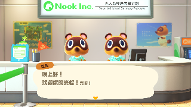
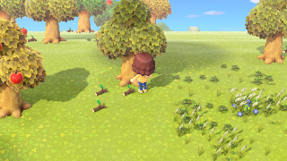
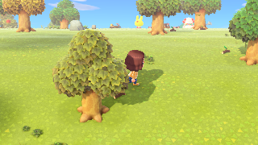
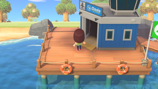
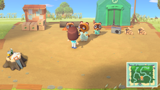
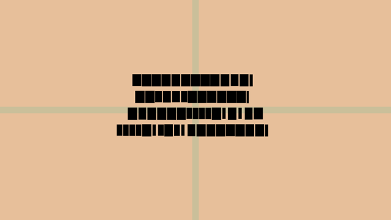

# Switch 游戏原生移植到 Apple 平台 · Claude Code skill

把《集合啦！动物森友会》(Switch 版) 原生跑上 Apple TV 4K 的全过程经验，加上社区同类项目的公开做法，蒸馏成一份可复用的 Claude Code skill。

「原生」的含义：游戏自带的 ARM64 代码原样在 Apple Silicon 上执行，不做 CPU 模拟；系统服务由宿主 HLE 顶替；图形从 NVN 重写到 Metal；着色器离线翻译。

## 在 Apple TV 上跑起来的动森

| 截图 | 说明 |
|---|---|
|  | Apple TV 4K（第 3 代）实机：豆狸的中文对话「晚上好！欢迎你的光临！」 |
|  | Apple TV 实机：岛上画面 |
|  | Apple TV 实机：岛上画面（另一处） |
|  | 合成测试 NSO 在 Apple TV 上画出的预期画面——loader → 指令改写 → HLE 导入 → 客体线程 → NVN→Metal 全链路的像素级验收 |
|  | Mac 宿主原生执行：岛上码头 |
|  | Mac 宿主：广场 |
|  | 自研底座路线的第一帧：第 300 帧起出现非纯色 UI |

截图是作者自己设备上的运行画面，缩到 320×180 左右，仓库里只放这几张。

## 安装

把本仓库放到 Claude Code 的 skills 目录：

```bash
git clone <本仓库地址> ~/.claude/skills/switch-appletv-port
```

或放进某个项目的 `.claude/skills/`。之后遇到「把 Switch 游戏移植到 iPhone/Mac/Apple TV」「NVN→Metal」「Switch 原生移植黑屏/没声音」这类请求，Claude Code 会自动加载；也可以用 `/switch-appletv-port` 手动触发。

## 内容地图

| 文件 | 内容 |
|---|---|
| `SKILL.md` | 入口：心智模型、工作流、症状分诊、硬规矩 |
| `references/01-route.md` | 路线选型：为什么不模拟 CPU、改写哪些指令、HLE 做在哪层、NVN→Metal、离线 shader |
| `references/02-bringup-checklist.md` | 从 NSP+keys 到第一帧的检查单 |
| `references/03-first-frame-pitfalls.md` | 黑屏/崩溃根因目录（症状 → 定位 → 修法） |
| `references/04-apple-tv.md` | tvOS 专题：内存上限、W^X、看门狗、可写目录、纹理包、手柄、截图回传 |
| `references/05-perf.md` | 首帧 236 s→1.7 s、预热与离线管线、TBDR、户外帧率 |
| `references/06-audio.md` | audren 两条路、REV15、SDK 20 静音兼容包、RMS 取证 |
| `references/07-agent-workflow.md` | 多 agent 推进方式：规格驱动、跨模型族复审、双路线竞速 |
| `references/08-community.md` | 社区项目做法：d2r-mobile、nxnative、nx-port、bellpad |

## 免责声明

- 本仓库**不含任何游戏代码、资源、keys**：没有反汇编、没有着色器源码、没有游戏文件内容，只有工程经验、API 名与服务名。
- 照本 skill 移植游戏，需要你自己**合法拥有**游戏本体，并从**你自己的主机**导出 keys。
- 任天堂、《集合啦！动物森友会》及相关商标归任天堂所有；本项目与任天堂无任何隶属关系。
- 本仓库内容以 MIT 许可发布，见 [LICENSE](LICENSE)。

## 致谢

本 skill 的经验来自两条自研路线与四个社区项目，全部感谢原作者：

| 项目 | 作者 | 许可 | 借鉴内容 |
|---|---|---|---|
| [d2r-mobile](https://github.com/jhaizhou-ops/d2r-mobile) | jhaizhou-ops | MIT | 整条原生执行路线、NVN→Metal 记录/回放、内存按需驻留、官方 tvOS 目标 |
| [nxnative](https://github.com/seedds/smbw-mobile)（原 smbw-mobile） | seedds | MIT | game profile、RomFS 目录索引、present interval 档案化、docs/agents 故障目录 |
| [nx-port](https://github.com/Johnoooob/nx-port) | Johnoooob | MIT | 运行时着色器记录、.nro 动态模块、差异行为开关化 |
| [bellpad](https://github.com/chrissotraidis/bellpad) | chrissotraidis 及 ac-decomp 社区 | CC0/MIT 混合 | decomp 路线对照、60 Hz 帧节奏契约、合规栈 |
| Ryujinx | Ryujinx 团队 | MIT | 着色器翻译器与 audren 实现的固定版本参考 |
